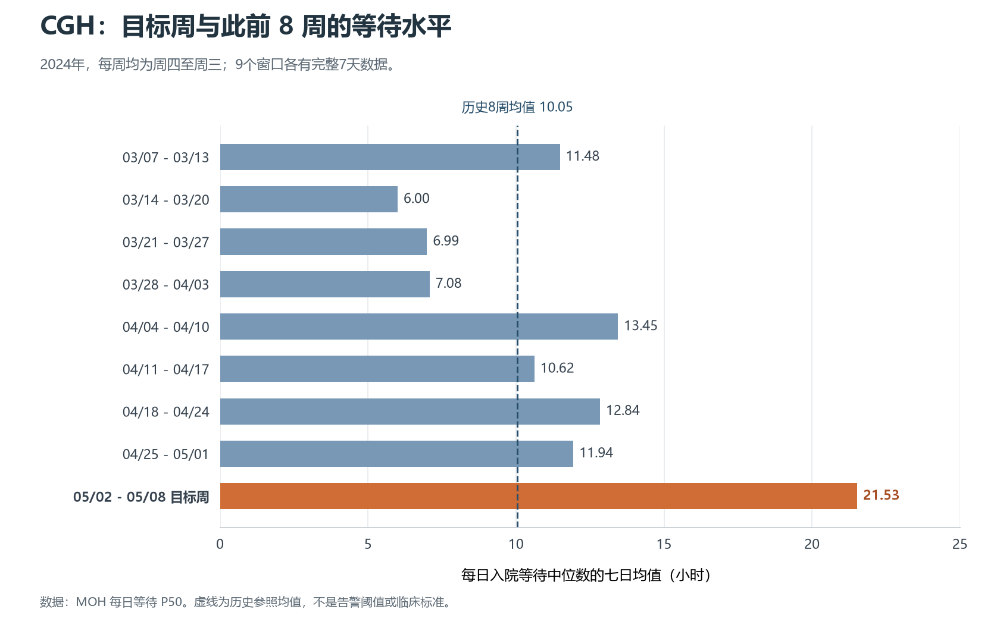

# CGH 目标周与历史基线

目标：把 2024-05-02 至 05-08 的等待水平及周间增幅，放回 CGH 自己此前的历史中比较。所有周统计都是“每日入院等待中位数的七日简单平均”，单位小时。

## 基线怎样选

主基线为目标周之前连续8个完整周，2024-03-07 至 05-01，共56个日值。每周周四至周三，与目标窗口星期构成一致且互不重叠。另检查4周、12周，以观察选择不同历史长度时结果是否改变。8周是本次探索的分析选择，不是 MOH 标准、临床阈值或经回测选出的最佳长度。

基线不包含目标周或目标周之后的数据。它描述最近一段历史，不等同于正常、安全或理想水平。即使使用不重叠周，相邻周仍可能相关；56天和8个周统计也不等于患者样本数。

## 每周数值

| 窗口 | 每日P50的七日均值（小时） | 有效日数 |
|---|---:|---:|
| 2024-03-07 至 2024-03-13 | 11.48 | 7 |
| 2024-03-14 至 2024-03-20 | 6.00 | 7 |
| 2024-03-21 至 2024-03-27 | 6.99 | 7 |
| 2024-03-28 至 2024-04-03 | 7.08 | 7 |
| 2024-04-04 至 2024-04-10 | 13.45 | 7 |
| 2024-04-11 至 2024-04-17 | 10.62 | 7 |
| 2024-04-18 至 2024-04-24 | 12.84 | 7 |
| 2024-04-25 至 2024-05-01 | 11.94 | 7 |
| 2024-05-02 至 2024-05-08 | 21.53 | 7 |

## 两种比较回答两个问题

1. **水平是否高于近期参照？** 8周均值为 10.05 小时，8个周值范围为 6.00—13.45 小时。目标周 21.53 小时，比基线均值高 11.48 小时，是其 2.14 倍，也高于这8个历史周的最高值。基线均值是8个周均值再平均，因各周都有7天，它也等于56个日P50的简单平均；不是56天全部患者的平均等待。
2. **与前周相比的增加幅度是否突出？** 目标周较前周增加 9.59 小时；基线8周内部共有7次相邻周变化，其中最大上升为 6.36 小时。目标增幅大于这7次变化中的最大上升，但7次变化不足以估计可靠的异常概率。

上述结果支持“相对所选近期历史，目标周等待偏高且增幅突出”，不支持“已达到统计显著异常”或“已证明缺人”。超过有限历史最大值，也不能直接称为95%/99%置信或确定告警。

## 改变历史长度后的检查

| 基线长度 | 覆盖日期 | 基线均值（小时） | 各周值最小—最大（小时） | 目标/基线均值 |
|---|---|---:|---:|---:|
| 4周 | 2024-04-04 至 2024-05-01 | 12.21 | 10.62—13.45 | 1.76倍 |
| 8周 | 2024-03-07 至 2024-05-01 | 10.05 | 6.00—13.45 | 2.14倍 |
| 12周 | 2024-02-08 至 2024-05-01 | 9.81 | 3.96—15.21 | 2.20倍 |

目标高于三个基线各自的最高周值，但4周参照均值高于8周和12周参照。这说明“偏高”的方向在这些选择下保持一致，具体倍数则依赖参照。没有由此宣称任意基线下都成立。未调整节假日、病例结构、季节性、人员或流程变化。

## 来源与复核

使用已核验底表的 CGH 等待字段，并核对原件 `入院等待时间_WT_week36Y2026.xlsx` 哈希、日期唯一性、每周完整日历及非空值。逐日原值和原单元格位置、12周统计及比较结果保存在 `处理脚本/.work_baseline/cgh_baseline_audit.json`，脚本为 `处理脚本/07_cgh_historical_baseline.py`。原件未修改。

目标周是从更长历史中事后选出的高点；尽管此次基线仅使用目标周之前的记录，本步仍是事后描述性分析，不是模拟成功提前预警。未来若制定告警规则，应另用此前数据设定规则并在未用于选例的后续时段验证误报、漏报和提前量。
