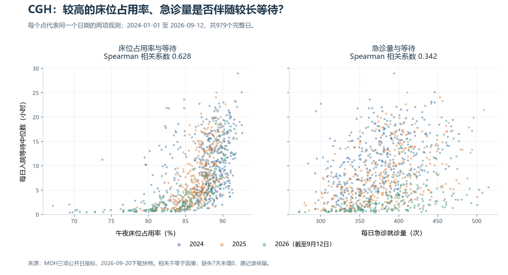

# CGH 三指标日度相关分析

问题：在CGH同一家医院内，记录日期上床位占用率或急诊量较高的日子，入院等待日P50是否也往往较高？本步使用实际公开数据寻找关联线索，没有假定它们是等待变化的原因。

## 数据与完整性

研究范围2024-01-01至2026-09-12，共986个自然日。两组相关都使用三指标同时非空的同一组979个医院日期观测，便于比较；它们不是患者样本数。2026-08-02至08-08共7天缺急诊与等待记录，因此不能参与本步配对计算；原底表中的BOR记录保留，没有填0或删除原始行。2024、2025、2026分别有366、365、248个完整日。

等待为每日入院等待中位数（小时）；急诊量为每日就诊次数；BOR原始为比例，图中乘100显示百分数。日期键唯一，原三Excel的SHA-256均已核对。未拼接其他医院、未把周均值混入日度样本、未只选择五月高值周，也没有去除真实高值。

## 分析方法

主要使用Spearman秩相关：把每天的两个指标分别从小到大排序，并列值取平均名次，再计算名次间的相关。它描述两个指标是否倾向于一起升高或一个升高另一个降低，不要求这种关系由一条直线表示；排序不消除共同趋势、混杂或所有极端值影响。

系数范围为-1至1。越接近1，数值排名越倾向同向；越接近-1，越倾向反向；接近0表示没有明显的单调关联，但不能据此否定其他关系。系数不是百分比，不是每增加一个单位带来的等待小时数，也不是预测准确率。

补充Pearson作为线性关联描述；另分年份重算，检查方向和强弱是否随时期变化。这只是分层描述，不等于已控制季节、星期或病例构成。没有独立性假设下的显著性检验或因果模型。

## 结果

| 时期 | 完整日数 | BOR与等待 Spearman | 急诊量与等待 Spearman | BOR与等待 Pearson | 急诊量与等待 Pearson |
|---|---:|---:|---:|---:|---:|
| 全期 | 979 | 0.628 | 0.342 | 0.536 | 0.318 |
| 2024年 | 366 | 0.294 | 0.460 | 0.275 | 0.435 |
| 2025年 | 365 | 0.681 | 0.473 | 0.623 | 0.458 |
| 2026年（截至09-12） | 248 | 0.780 | 0.472 | 0.606 | 0.361 |

全期BOR与等待秩相关约0.628，急诊量与等待约0.342。这表示在本医院、此期间、此日度口径下，两者均与等待呈正向单调关联，前者的样本系数更大；不能把系数差当成“谁的因果影响更大”，也不能把0.628解释为62.8%的等待由床位占用率造成。

分年检查提供了一个实际限制：2024年BOR与等待的秩相关约0.294，急诊量与等待约0.460，强弱顺序与全期不同；2025及2026样本中BOR系数则较高。因此全期关联强弱不能作为每年都适用的固定排名，也不能据此排除2024年急诊需求的作用。分年差异的成因仍未确认。

图中每个点对应一个医院日期，横坐标是BOR或急诊量，纵坐标是当日等待P50；颜色表示年份。点云并不落在一条线上，说明仅凭某个横轴数值无法确定当天等待。年度系数的变化应与完整散点一起检查，不只引用全期一个数字。

## 能支持什么，不能支持什么

本步支持把需求、床位相关情况作为后续核查线索，不能证明其引起等待延长。午夜BOR是存量快照，急诊量是日流量，而等待是特定急诊入院人群的日P50；记录日期对齐不证明因果先后，统计日归属和BOR分母详细范围仍需核实。也不能用这些相关系数说明五月某一周的具体原因、需要招聘多少人或增加多少床。

相邻日可能相关，星期、季节、疾病背景、病例构成和资源变化都可能影响结果；本分析尚未调整这些因素。2026年不是完整年度，分年差异也可能与覆盖季节有关。没有事件真值标签、预测划分或业务执行数据，所以不报告异常准确率、预测效果、策略采纳率或等待改善。

## 可复现与来源

脚本：`处理脚本/11_cgh_daily_association.py`；详细系数、979个日值及各自原Excel单元格、排除的7个日期和三份原件哈希保存在`处理脚本/.work_association/cgh_daily_association_audit.json`。原始文件未改动。
