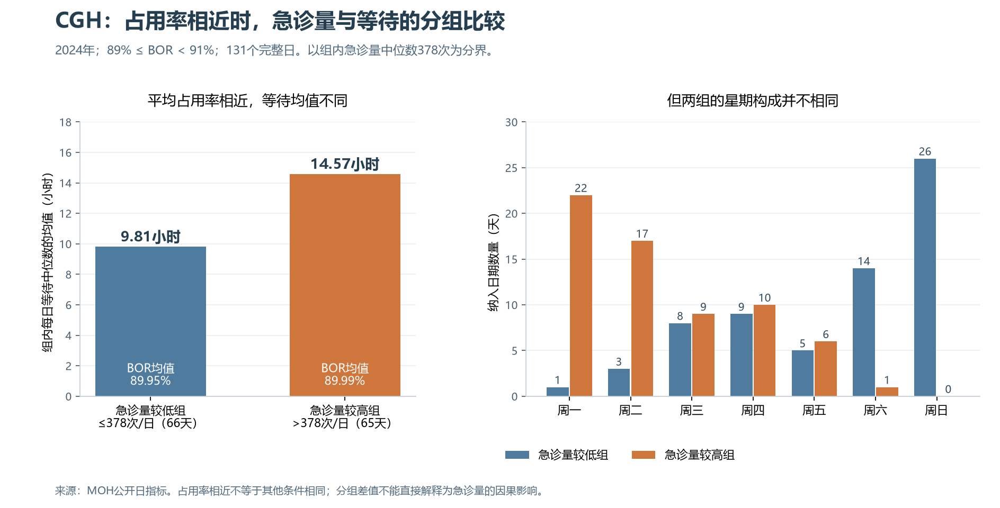

# CGH：在相近床位占用率下比较急诊量与星期

本步用已有日数据继续检查关联：占用率相近的日期，急诊量和星期几是否伴随不同的等待水平？这是探索性的分组比较，不是预测模型或因果估计。

## 怎样选数据

1. 先限定2024年CGH，366个日期的三指标均完整。前课发现分年相关强弱不同，本步先不混合年份，也与2024年五月案例处于同一年。
2. 选原始午夜BOR满足89%≤BOR<91%的日期，共131天。区间围绕前课图中讨论的90%作教学选择，不是医疗阈值；没有先把BOR四舍五入再筛选。
3. 在这131天中，计算急诊量中位数378次，以≤中位数和>中位数分组。恰好等于中位数的2天归较低组。所谓高低仅相对此样本，不是官方拥挤标准。
4. 每组计算日期数、急诊量范围和均值、BOR均值、每日等待P50的简单均值；然后检查星期构成及星期内部的分组结果。日期是样本单位，不能当成患者人数。

## 两组总体比较

| 急诊量组别（次/日） | 天数 | 急诊量范围 | 急诊量均值 | BOR均值 | 每日P50均值（小时） |
|---|---:|---:|---:|---:|---:|
| 较低组：急诊量≤378 | 66 | 293—378 | 340.38 | 89.95% | 9.81 |
| 较高组：急诊量>378 | 65 | 379—477 | 415.57 | 89.99% | 14.57 |

较高组比低组的等待均值高4.76小时，两组BOR均值仅相差0.0425个百分点。但BOR落入同一范围、均值接近，不等于所有条件相同；不能把4.76小时称为“急诊量增加造成的等待”。

## 星期构成为什么要检查

较低组有40/66个周六或周日，占60.61%；较高组仅1/65，占1.54%。两组同时在急诊量与星期构成上不同，无法把差值单独归给其中一个因素。这里“周末”只指周六周日，没有把公众假期划成工作日或非工作日。

在同一个BOR范围内，单按星期汇总：

| 星期 | 天数 | 急诊量均值（次） | BOR均值 | 每日等待P50均值（小时） |
|---|---:|---:|---:|---:|
| 周一 | 23 | 434.87 | 89.97% | 14.41 |
| 周二 | 20 | 404.40 | 89.94% | 15.41 |
| 周三 | 17 | 385.41 | 90.09% | 13.92 |
| 周四 | 19 | 372.42 | 90.11% | 12.81 |
| 周五 | 11 | 377.45 | 89.80% | 13.40 |
| 周六 | 15 | 331.40 | 89.88% | 8.79 |
| 周日 | 26 | 332.15 | 89.94% | 7.51 |

这个样本中的星期差异可以作为进一步调查线索，不说明星期本身造成等待，也不能直接推断周末有更多人员或流程更好。

## 再细分后，有些组并没有足够的可比日期

同一378次分界下，逐星期比较：

| 星期 | 较低组天数 | 较低组等待均值 | 较高组天数 | 较高组等待均值 |
|---|---:|---:|---:|---:|
| 周一 | 1 | 3.34 | 22 | 14.91 |
| 周二 | 3 | 14.23 | 17 | 15.62 |
| 周三 | 8 | 12.25 | 9 | 15.42 |
| 周四 | 9 | 11.81 | 10 | 13.70 |
| 周五 | 5 | 14.67 | 6 | 12.35 |
| 周六 | 14 | 9.15 | 1 | 3.75 |
| 周日 | 26 | 7.51 | 0 | 不适用 |

周一较低组仅1天、周六较高组仅1天，周日没有较高组；0天组的均值应显示“不适用”，不能填0小时。周五、周六的均值方向与整体不同，也不能据这些小组断言稳定反向关系。星期相同后仍可能有BOR具体数值、月份、病例、床位类型等差异，目前没有充分调整这些因素。

## 改变区间后的描述性检查

将BOR范围放宽到88%≤BOR<92%，得到229天；在新样本重新按急诊量中位数379次分组：

| 急诊量组别（次/日） | 天数 | 急诊量范围 | 急诊量均值 | BOR均值 | 每日P50均值（小时） |
|---|---:|---:|---:|---:|---:|
| 较低组：急诊量≤379 | 117 | 293—379 | 345.98 | 89.50% | 9.83 |
| 较高组：急诊量>379 | 112 | 380—477 | 414.49 | 89.79% | 13.90 |

本次放宽区间后，较高组的等待均值仍较高。但样本、中位数分界和BOR组间差异同时改变，这只检查所选另一种分组下的描述方向，不是因果或预测增益验证，没有搜索最佳区间。

## 当前结论及业务用途

在所选2024年CGH、89%—不足91%的BOR样本中，急诊量较高组有更高的等待均值，星期构成也明显不同。结果支持在看板中同时查看急诊量和星期信息，并为后续比较检查可比日期；不能确定二者各自的独立作用，也不能据此直接制定排班或招聘数量。小样本分组说明进一步细分并非总能产生可靠比较。

等待是入院相关人群的日P50，急诊量是全部急诊就诊次数，BOR是午夜快照；记录日期一致不代表同一批患者或先后因果关系。本步未调整日期自相关、节假日、病例或资源变化，未做显著性检验、预测评估或策略效果评估。

## 可复现与来源

脚本为`处理脚本/12_cgh_similar_bor_groups.py`，读取前课已核验的完整日记录并重新核对三份原始Excel哈希。脚本验证2024年完整日期和唯一性，检查各分组天数能回加至选定样本；详细日值与原单元格、主分析及敏感性参数保存在`处理脚本/.work_association/cgh_similar_bor_groups_audit.json`。没有改动原始记录，其他年份及区间外日期仍保留在底表。
